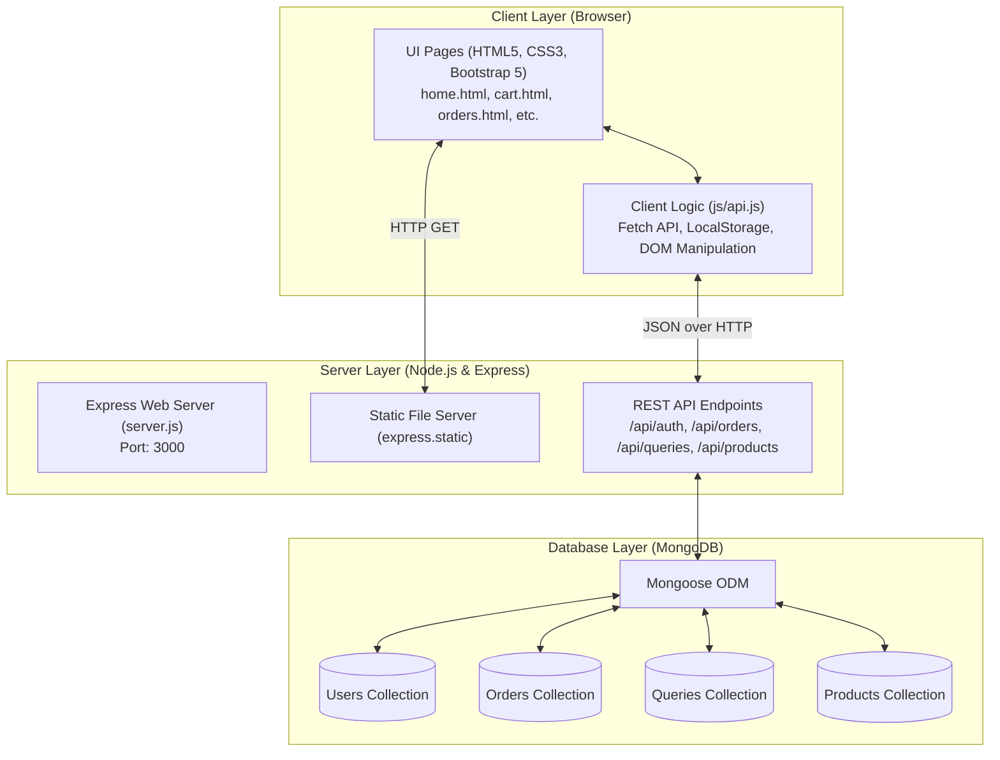

# 📄 PROJECT REPORT

## PROJECT TITLE: **WRIST WONDERS — Full-Stack E-Commerce Watch Store Web Application**

---

### 1. ABSTRACT
**Wrist Wonders** is a full-stack e-commerce web platform designed for showcasing, purchasing, and managing modern wristwatches and related accessories. The application provides an engaging, responsive user interface built using **HTML5**, **CSS3**, **JavaScript (ES6+)**, and **Bootstrap 5**, coupled with an efficient, scalable backend powered by **Node.js** and **Express.js**. Persistent data storage is managed using **MongoDB** with **Mongoose ODM**. Key functional features include categorized product browsing (Men's, Women's, Kids, Smart, Analog, and Accessories), dynamic shopping cart management, authenticated checkout enforcement (requiring user sign-up or login before order placement), real-time order processing, a dedicated order history tracking system, and a customer query/feedback handler.

---

### 2. INTRODUCTION & OBJECTIVES

#### 2.1 Background
The wristwatch market blends traditional luxury horology with modern smart wearable technology. Online shoppers require an intuitive, fast, and seamless e-commerce journey: from discovering watches to inspecting specifications, adding to cart, completing authentication, placing orders, and tracking past purchases.

#### 2.2 Problem Statement
Static showcase websites lack dynamic interactivity, user authentication, cart management, and database persistence. Without a backend and database:
- User accounts cannot be saved or authenticated.
- Cart items and customer orders are lost on page refresh.
- Feedback and queries cannot be stored or tracked by the store administrator.

#### 2.3 Project Objectives
1. **Responsive Storefront**: Deliver an intuitive, mobile-friendly interface for browsing watches across multiple categories.
2. **Dynamic Cart System**: Allow users to add watches to their cart, with immediate redirection to a dedicated cart page for quantity adjustments and total calculation.
3. **Mandatory User Authentication**: Ensure that customers must register (Sign Up) or authenticate (Login) before order placement to prevent anonymous or unverified orders.
4. **Persistent Order Management**: Store all placed orders in MongoDB with customer details, item breakdowns, total price, and shipping address.
5. **Order History Tracking**: Allow logged-in customers to view all their historical purchases with date, itemized list, and delivery status.
6. **Customer Query Handling**: Provide a feedback/query submission mechanism stored persistently in the database.

---

### 3. SYSTEM ARCHITECTURE

The application adopts a **Client-Server Architecture** utilizing a **RESTful API** communication pattern:



#### Workflow Stages:
1. **Browsing**: The client requests HTML/CSS/JS assets served by Express static middleware.
2. **Cart Action**: Clicking "Add to Cart" stores item data into client storage and immediately directs the browser to cart.html.
3. **Authentication Check**: The cart inspects client session state. If unauthenticated, it presents Login/Sign-up options; if authenticated, it exposes delivery details and the confirmation action.
4. **Order Dispatch**: Client issues an asynchronous `POST` request to `/api/orders`. Node.js validates user existence in MongoDB, commits the order document, and replies with confirmation data.
5. **History Inquiry**: orders.html issues a `GET` request to `/api/orders/user/:email`, dynamically rendering previous purchases.

---

### 4. TECHNOLOGY STACK SPECIFICATION

#### 4.1 Frontend Technologies
- **HTML5**: Semantic document structuring for all views (`home.html`, `cart.html`, `orders.html`, `sign up.html`, `log-in.html`, `QUERY.HTML`, category pages).
- **CSS3**: Custom visual themes, responsive media queries, sticky summary sidebars, and styled cards (`style.css`).
- **Bootstrap 5 (`v5.2.1`)**: Component framework utilized for grid layouts, carousels, responsive navigation bars, dropdowns, alerts, and badges.
- **Font Awesome (`v6.2.0`)**: Vector icons for shopping carts, user avatars, watches, feedback icons, and status badges.
- **JavaScript (ES6+)**: Asynchronous client-side logic (`js/api.js`), utilizing `fetch()` for API communication and `localStorage` for cart persistence.

#### 4.2 Backend Technologies
- **Node.js**: Asynchronous, event-driven JavaScript server runtime.
- **Express.js (`v4.19.2`)**: Minimalist web application framework handling HTTP routing, static file delivery, and JSON request body parsing.
- **Mongoose (`v8.4.1`)**: Object Data Modeling (ODM) library providing schema validation, type casting, and query construction for MongoDB.
- **dotenv (`v16.4.5`)**: Environment variable management (`PORT`, `MONGODB_URI`).

#### 4.3 Database Technology
- **MongoDB**: High-performance NoSQL document database storing unstructured and semi-structured documents in native JSON-like (BSON) format.

---

### 5. DATABASE SCHEMA & DATA MODELS

All data schemas are defined via Mongoose in `server.js`:

#### 5.1 User Collection (`User`)
Stores customer authentication records:
| Field | Type | Attributes | Description |
|---|---|---|---|
| `_id` | ObjectId | Primary Key, Auto | Unique user identifier |
| `name` | String | Required, Trimmed | Full customer name |
| `email` | String | Required, Unique, Lowercase | Customer email address |
| `password` | String | Required | Customer password |
| `createdAt` | Date | Auto Timestamp | Account registration date |
| `updatedAt` | Date | Auto Timestamp | Last account update date |

#### 5.2 Order Collection (`Order`)
Stores purchase transactions:
| Field | Type | Attributes | Description |
|---|---|---|---|
| `_id` | ObjectId | Primary Key, Auto | Unique order ID |
| `customerName` | String | Required | Name of the purchasing customer |
| `customerEmail` | String | Required | Email associated with customer account |
| `items` | Array | Required | List of items (name, price, image, quantity) |
| `totalAmount` | Number | Required | Total payable price in Rs. |
| `shippingAddress` | String | Required | Physical delivery location |
| `phone` | String | Optional | Contact phone number |
| `status` | String | Default: `"Confirmed"` | Order fulfillment state |
| `createdAt` | Date | Auto Timestamp | Order placement timestamp |

#### 5.3 Query Collection (`Query`)
Stores contact messages and inquiries:
| Field | Type | Attributes | Description |
|---|---|---|---|
| `_id` | ObjectId | Primary Key, Auto | Unique query ID |
| `name` | String | Default: `"Customer"` | Submitter name |
| `email` | String | Required | Submitter email address |
| `message` | String | Required | Inquired text or feedback |
| `status` | String | Default: `"pending"` | Query review status |
| `createdAt` | Date | Auto Timestamp | Submission timestamp |

#### 5.4 Product Collection (`Product`)
Stores watches and catalog assets:
| Field | Type | Attributes | Description |
|---|---|---|---|
| `_id` | ObjectId | Primary Key, Auto | Unique product ID |
| `name` | String | Required | Watch model name |
| `brand` | String | Required | Brand (Titan, Fastrack, Sonata, etc.) |
| `category` | String | Required | mens, womens, kids, smart, analog |
| `price` | Number | Required | Watch price in Rs. |
| `imageUrl` | String | Required | Public image URL |
| `rating` | Number | Default: `4.5` | Customer star rating |
| `inStock` | Boolean | Default: `true` | Inventory availability |

---

### 6. KEY FUNCTIONAL MODULES

#### 6.1 Catalog & Product Showcase
- Users browse featured watches on the homepage and dedicated category views:
  - **Smart Watches**: `Smart .html`
  - **Analog Watches**: `analog.html`
  - **Men's Collection**: `Mens.html`
  - **Women's Collection**: `Womens.html`
  - **Kids' Collection**: `kids.html`
  - **Accessories**: `accessiores.html`

#### 6.2 Cart Navigation & Management
- Every watch card possesses an active **"Add To Cart"** button.
- Clicking the button extracts item details (title, price, image), persists it to client storage, and immediately redirects the browser to `cart.html`.
- Users can dynamically modify quantities (`+` or `-`), delete individual items, or review subtotal and free shipping estimates.

#### 6.3 Gatekept Checkout (Mandatory Login / Sign Up)
- Orders cannot be placed anonymously.
- If a guest accesses `cart.html`, the checkout section locks with a notification prompt and directs the user to `log-in.html` or `sign up.html`.
- Once logged in, the cart unlocks shipping address inputs, phone fields, and the **"Confirm & Place Order"** button.

#### 6.4 Order Processing & Order History
- Upon submission, the order document is recorded in MongoDB.
- Customers can visit `orders.html` or click **"My Orders"** in the navigation bar to review all past orders, delivery addresses, dates, and order status.

#### 6.5 Customer Query Handling
- `QUERY.HTML` submits inquiries directly to `/api/queries`, enabling persistent customer relationship handling in MongoDB without page reloads.

---

### 7. REST API SPECIFICATION

| Method | Endpoint | Description | Request Body | Response |
|---|---|---|---|---|
| `POST` | `/api/auth/signup` | Registers new user | `{ name, email, password }` | `{ success: true, user: {...} }` |
| `POST` | `/api/auth/login` | Authenticates user | `{ email, password }` | `{ success: true, user: {...} }` |
| `GET` | `/api/auth/users` | Lists registered accounts | None | `{ success: true, users: [...] }` |
| `POST` | `/api/orders` | Creates new order in MongoDB | `{ customerName, customerEmail, items, totalAmount, shippingAddress, phone }` | `{ success: true, order: {...} }` |
| `GET` | `/api/orders/user/:email` | Retrieves user's order history | None (URL parameter) | `{ success: true, orders: [...] }` |
| `GET` | `/api/orders` | Retrieves all orders | None | `{ success: true, orders: [...] }` |
| `POST` | `/api/queries` | Submits feedback/query | `{ name, email, message }` | `{ success: true, query: {...} }` |
| `GET` | `/api/queries` | Fetches feedback queries | None | `{ success: true, queries: [...] }` |
| `DELETE`| `/api/queries/:id` | Deletes a query | None | `{ success: true }` |
| `GET` | `/api/products` | Lists products / search | Query params (`?category=...`) | `{ success: true, products: [...] }` |
| `GET` | `/api/health` | Server health check | None | `{ status: "OK" }` |

---

### 8. SYSTEM VERIFICATION & TESTING

| Test Case ID | Feature Tested | Input / Action | Expected Result | Status |
|---|---|---|---|---|
| **TC-01** | User Registration | Valid name, email, password on `sign up.html` | Record created in MongoDB `users` collection; user session saved | **PASSED** |
| **TC-02** | Duplicate Registration | Existing registered email | Returns HTTP 400 with duplicate email error alert | **PASSED** |
| **TC-03** | User Authentication | Correct credentials on `log-in.html` | User verified; session created; navbar displays user greeting | **PASSED** |
| **TC-04** | Add to Cart Redirection | Click "Add To Cart" on any product card | Item added to cart; browser opens `cart.html` immediately | **PASSED** |
| **TC-05** | Guest Order Restriction | Navigate to `cart.html` without logging in | Checkout form locked; prompts login/signup buttons | **PASSED** |
| **TC-06** | Order Placement | Logged-in user enters address & confirms | Order committed to MongoDB `orders` collection; cart emptied | **PASSED** |
| **TC-07** | Order History Display | Logged-in user visits `orders.html` | Historical orders rendered with items, total, date, status | **PASSED** |
| **TC-08** | Query Submission | Fill and submit query form in `QUERY.HTML` | Query stored in MongoDB `queries` collection with feedback banner | **PASSED** |

---

### 9. PROJECT DEPLOYMENT & USAGE

#### Prerequisites
- **Node.js** (`v18+` or `v20+`)
- **MongoDB** running on `127.0.0.1:27017`

#### Execution Methods
1. **One-Click Startup (Windows)**:
   - Double-click `start.bat`. It automatically starts MongoDB, verifies dependencies, starts the Node server, and opens your browser.
2. **Terminal Execution**:
   ```bash
   node server.js
   ```
3. **Application URL**:
   - Access **`http://localhost:3000`** in any web browser.

---

### 10. CONCLUSION & FUTURE SCOPE

#### 10.1 Conclusion
The **Wrist Wonders** web application fulfills all requirements of a modern full-stack e-commerce project. By replacing static placeholders with an integrated **Node.js, Express, and MongoDB** infrastructure, the platform delivers secure customer authentication, interactive cart management, dynamic order confirmation, and complete purchase tracking.

#### 10.2 Future Scope
- Integration with live payment gateways (Stripe, Razorpay, or PayPal).
- Email notifications on order confirmation using Nodemailer.
- Real-time order shipping tracking with SMS alerts.
- Product reviews and star ratings submitted directly by verified buyers.
